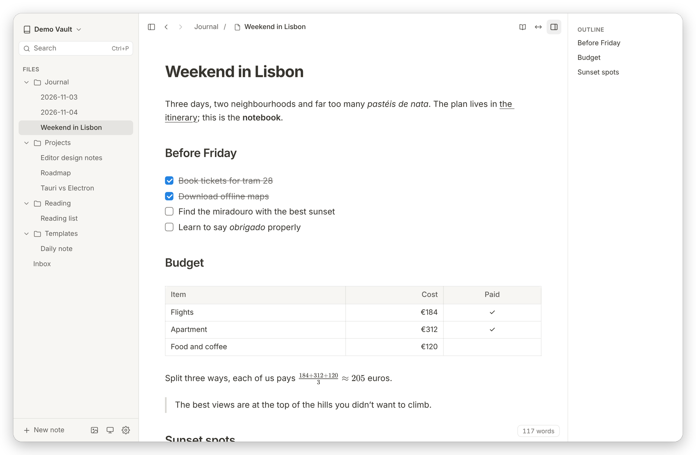
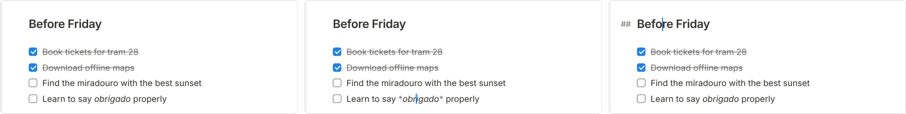
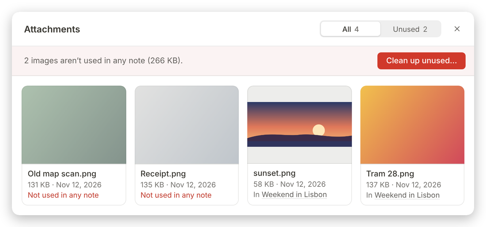
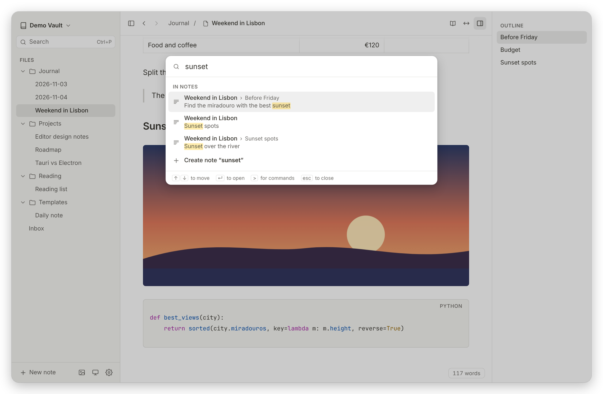
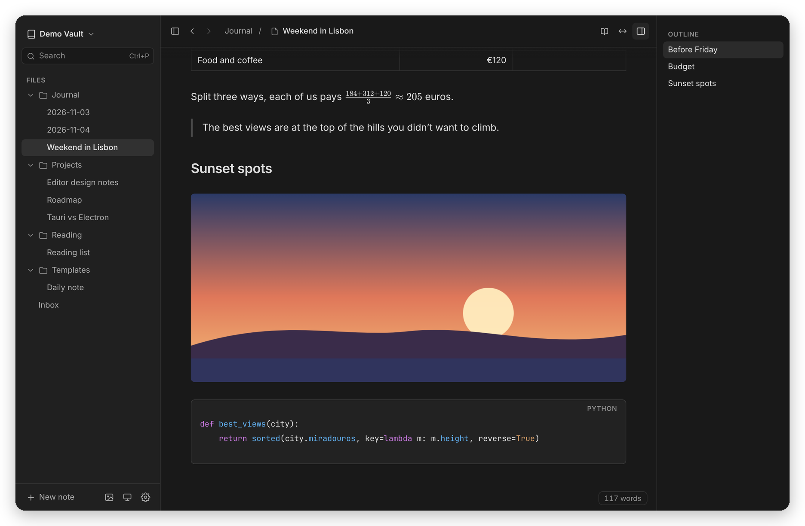

<p align="center">
  
</p>

<h1 align="center">Margin</h1>

<p align="center">
  A calm Markdown editor for your own folder of notes.<br>
  Always rendered, never a preview pane, and every note stays a plain <code>.md</code> file.
</p>

<p align="center">
  
</p>

## What it is

Margin is a desktop app for writing in Markdown that looks like a finished page
while you write it. There's no split view and no preview button: headings,
lists, tables, images and maths are rendered in place, and only the part you're
editing shows its Markdown. Click into a bold word and its `**` appear; click
away and they're gone. Nothing on the page jumps around when that happens.

Your notes are ordinary Markdown files in a folder you choose (a *vault*).
Margin doesn't copy them into a database, so you can open the same folder in
Obsidian, Typora, VS Code or GitHub, back it up any way you like, or sync it
with iCloud Drive.

It's built for the Mac, with a native menu bar, a translucent sidebar, trackpad
swipes and a light or dark look that follows your system. It builds for Windows
and Linux too.

## Features

### Writing

<p align="center">
  
</p>
<p align="center"><sub>The same lines as they read (left), with the caret in an italic word, which shows its <code>*</code> (middle), and with the caret on a heading, whose <code>##</code> appears in the margin (right).</sub></p>

- **Live preview.** Only the element under the caret reveals its Markdown.
  Heading `#`s and quote `>`s appear in the left margin, so text never shifts
  when you click into a line.
- **Everything you'd expect from Markdown:** headings, emphasis, links, lists,
  task lists with real checkboxes, quotes, tables (with formatting inside
  cells), code blocks with syntax highlighting, horizontal rules and YAML front
  matter.
- **Maths** with `$…$` and `$$…$$`, rendered by KaTeX, offline.
- **Fast formatting:** type `/` for a block menu, select text for a formatting
  toolbar, or type `*`, `` ` `` or `$` over a selection to wrap it.
- **Smart typography:** “curly quotes”, em dashes from `--` and ellipses from
  `...` as you type (never inside code or maths, and one ⌘Z away from undoing).
- **Find and replace** in the note, with case, whole-word and regex options.

### Images

Paste a screenshot, drag in photos, or type `/image`. Each image is copied into
an `attachments` folder in your vault and linked with an ordinary relative
path, so other Markdown apps show it too.

When pictures pile up, **Manage Attachments** shows every image in the vault,
which notes use it, and lets you clear out the ones no note uses any more (they
go to the Trash, so nothing is lost by accident).

<p align="center">
  
</p>

### PDFs

PDFs in your vault folder show up in the sidebar next to your notes. Click one
to read it in Margin's own viewer, with page numbers, zoom (⌘+ and ⌘−) and text
you can select and copy. Margin remembers where you were in each PDF and
reloads it if the file changes. It never edits your PDFs.

### Finding your way

- **Quick switcher and full-text search** (⌘P): jump to a note by name, or to
  any line in any note. Results show which section a match is in.
- **Command palette** (⇧⌘P) for every action, with its shortcut.
- **Outline** of the note's sections, back and forward history (or a
  two-finger swipe), and links between notes that open in the app.

<p align="center">
  
</p>

### Organising

- A sidebar of notes and folders. Drag to move, rename in place, and sort by
  name, last edited or date created.
- **A note's title is its file name.** Edit the first heading and the file is
  renamed to match; rename the file and the heading follows.
- **Safe saving.** Notes save automatically as you type, never leave a
  half-written file behind, and are saved before the app quits. Changes made by
  other apps (or another computer, through sync) appear on their own.

### Reading and focus

- **Reading mode** (⇧⌘E) hides every bit of Markdown and makes the note
  read-only.
- **Focus mode** dims everything but the paragraph you're in; **typewriter
  mode** keeps the line you're writing in the middle of the window.
- Choose sans, serif or mono text, the text size and the line width, or let
  the page use the whole window.

<p align="center">
  
</p>

## Getting started

Margin doesn't ship prebuilt downloads yet, so you build it yourself. You'll
need [Node.js](https://nodejs.org) 22 or newer, [Rust](https://rustup.rs), and
the [Tauri prerequisites](https://v2.tauri.app/start/prerequisites/) for your
system (on a Mac, that's just the Xcode command line tools).

```bash
git clone https://github.com/kevzhuo/Margin.git
```

```bash
cd Margin && npm install
```

```bash
npm run tauri build
```

On a Mac the app appears in `src-tauri/target/release/bundle/macos/Margin.app`;
drag it into Applications. Windows and Linux installers are written next to it
in `src-tauri/target/release/bundle/`.

When you open Margin, choose a folder of notes (or create a new, empty vault).
To update later, pull the latest code and run the build command again.

## Keyboard shortcuts

On Windows and Linux, use Ctrl where these say ⌘.

| Shortcut | Action |
| --- | --- |
| ⌘P | Go to a note, or search every note |
| ⇧⌘P | Run any command |
| ⌘F | Find and replace in this note |
| ⌘N / ⇧⌘N | New note / new folder |
| ⌘[ / ⌘] | Back / forward |
| ⌘B, ⌘I, ⌘E, ⌘K | Bold, italic, inline code, link |
| ⌘1 – ⌘6, ⌘0 | Heading level, or plain text |
| ⌘Return | Tick or untick a task |
| ⇧⌘E | Reading mode |
| F8 / F9 | Focus mode / typewriter mode |
| ⌘\\ / ⇧⌘\\ | Show or hide the sidebar / outline |
| ⌘, | Settings |

Every other command, with its shortcut, is in the command palette (⇧⌘P) and the
menu bar.

## Development

Margin is a [Tauri 2](https://tauri.app) app: a small Rust shell around a web
interface written in TypeScript with React, and an editor built on
[CodeMirror 6](https://codemirror.net).

```bash
npm run dev
```

runs the interface in a browser with a built-in demo vault (no Rust needed), and

```bash
npm run tauri dev
```

runs the desktop app. Before sending a change, run the checks: type checking,
unit tests, and end-to-end tests that drive the real editor in Chromium.

```bash
npm run check
```

```bash
cd src-tauri && cargo test
```

How the live preview, saving and the rest work under the hood is described in
[docs/architecture.md](docs/architecture.md).

## Roadmap

Margin is young but complete enough for daily notes. Next up: keeping image and
note links working when notes are moved or renamed, wiki links and backlinks,
and export to PDF and HTML.

## License

[MIT](LICENSE)
