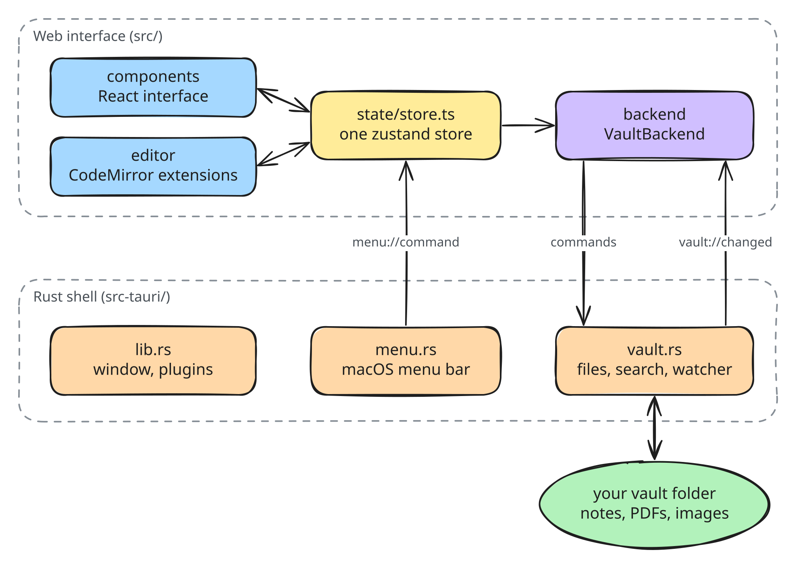
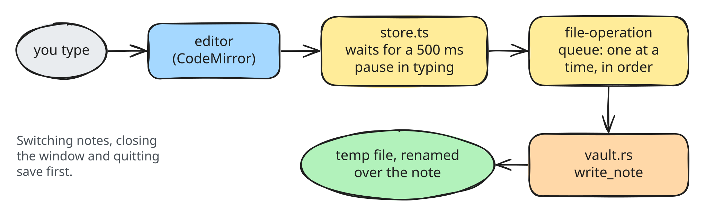
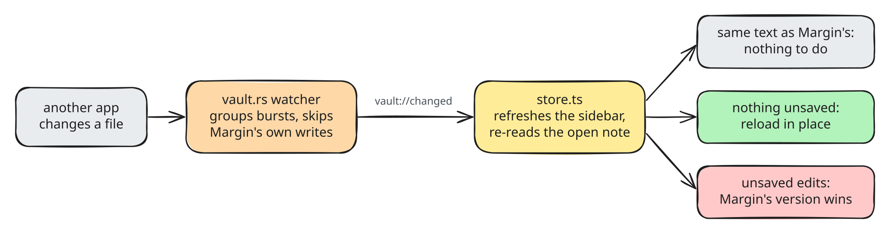

# Architecture

How Margin is put together, for anyone working on its code. For what the app
does and how to install it, see the [README](../README.md).

## The big picture

Margin is a [Tauri 2](https://tauri.app) app: a small Rust program owns the
window and the file system, and the interface runs in the operating system's
own web view (WebKit on macOS and Linux, WebView2 on Windows). The interface is
React and TypeScript, the editor is [CodeMirror 6](https://codemirror.net), and
the app's state lives in one [zustand](https://zustand.docs.pmnd.rs) store.

<p align="center">
  <picture>
    <source media="(prefers-color-scheme: dark)" srcset="diagrams/overview-dark.svg">
    
  </picture>
</p>

A few principles shape everything else:

- **Files on disk are the source of truth.** There is no database or index. The
  sidebar is a listing of the folder, a note's text is read from its file when
  it opens, and edits are written back to that file. Other apps can change the
  folder at any time, and Margin follows.
- **Only Rust touches the disk,** and only inside the open vault. The interface
  asks for everything through a small set of commands.
- **The interface doesn't know which backend it has.** In the desktop app it
  talks to Rust; in a browser (development and the end-to-end tests) it uses an
  in-memory vault with the same interface.
- **Typing never waits for anything.** Saving, the outline and the word count
  all happen after the keystroke, off React's render path.

## The Rust shell (`src-tauri/`)

| File | What it does |
| --- | --- |
| `lib.rs` | Builds the app: the dialog, opener and window-state plugins, the macOS menu, and the list of commands the interface may call. The window starts hidden and is shown once the interface has painted its first frame (or after 4 seconds, if it never does), so it never flashes white. |
| `vault.rs` | Every file-system operation, as Tauri commands. Its doc comment lists them. |
| `menu.rs` | The macOS menu bar, written as data (`id`, label, shortcut). Choosing an item sends its id to the interface as a `menu://command` event. Quit is Margin's own item, so the open note is saved first. |

`vault.rs` holds one `VaultState`: the open vault's root, the paths Margin wrote
recently, and the file watcher. Its rules:

- **Paths are confined to the vault.** Every path argument is resolved and
  checked against the vault root before anything happens; anything outside is
  refused. Opening a vault also allows the web view to load images and PDFs
  from that folder, and only that folder, through Tauri's asset protocol.
- **Writes are atomic.** A save writes a temporary file beside the note and
  renames it over the note, so a crash never leaves half a file. The new file
  takes on the note's permissions and creation date.
- **Nothing is overwritten or destroyed by accident.** Creating a note, folder
  or attachment picks a free name ("Note 2.md"), renames refuse to replace an
  existing file, and deletes go to the system Trash.
- **The watcher reports other apps' changes, not Margin's own.** It uses the
  `notify` crate, groups bursts of events over 200 ms, skips files Margin wrote
  in the last 1.5 s, and emits `vault://changed` with `{ kind, paths }`.

## The backend boundary (`src/backend/`)

`types.ts` defines `VaultBackend`, the one interface the rest of the app uses
for files: list the vault, read and write notes, create, rename and delete,
search, watch, save attachments, list images, and turn a file into a URL an
`` or the PDF viewer can load. It also holds the path helpers shared by
both sides of the app (joining, resolving and writing relative links, checking
a path is inside a folder).

- `tauri.ts` implements it with Tauri commands. Attachments are sent as raw
  bytes rather than JSON, so large images and PDFs stay fast.
- `memory.ts` implements it in memory, with a small demo vault saved in
  `localStorage`. It is what you see with `npm run dev`, and what the
  end-to-end tests drive.
- `index.ts` picks one at startup. Tests can inject their own through
  `window.__MARGIN_BACKEND__`.

## State (`src/state/`)

`store.ts` is a single zustand store. Components subscribe to the slices they
show, and everything that changes the app goes through its actions. It holds:

- **the vault:** its root, the file tree, which folders are expanded;
- **the open file:** its path and content, whether it has unsaved changes,
  back/forward history, recent notes, and the caret and scroll position
  remembered for each one;
- **settings:** theme, font, sizes, the writing switches, and sort order. They
  live in one list (`Settings` and its defaults), are saved to
  `localStorage` on every change, and are checked when loaded;
- **interface state:** which panels and dialogs are open, toasts, the table
  menu, and the PDF viewer's page, zoom and contents.

Two pieces deliberately live outside React state, in the store's module:

- **The save pipeline.** The latest text and the last saved text are plain
  variables, so a keystroke updates them without re-rendering anything. A
  save runs 500 ms after typing stops; a title change renames the file 700 ms
  after it stops.
- **The file-operation queue.** Saves, renames, moves and deletes run one at a
  time, in the order they were asked for, so an autosave can never land on a
  path that is in the middle of being renamed.

The other modules are small and mostly pure, which keeps them easy to test:

| Module | Role |
| --- | --- |
| `appCommands.ts` | Every command (title, shortcut, when it's available, what it runs). The command palette, the keyboard shortcuts and the menu bar all read this one list. |
| `menuBridge.ts` | Runs a menu bar item's command, and ignores the echo when a shortcut reaches the app both as a key press and as a menu event. |
| `title.ts` | A note's title (its first `#` heading) and the file name made from it. |
| `relink.ts` | The link edits that keep a note's links working after a file or folder moves. |
| `treeSort.ts` | Sorting the sidebar by name, last edited or date created. |
| `attachments.ts`, `attachmentUsage.ts` | Naming and linking pasted images; finding which notes use each image. |
| `fileDrops.ts` | Recognising files dropped on the window. |

## The editor (`src/editor/`)

`createEditor.ts` builds one CodeMirror editor out of focused extensions, each
in its own file: live preview, the slash menu, the selection toolbar, find and
replace, smart typography, table editing, images, maths, typewriter scrolling,
reading mode and so on. `components/EditorPane.tsx` owns the editor. Opening a
note gives it a fresh editor state (so undo history belongs to one note), and
the options it reads from the store are read when needed rather than captured,
so changing a setting never rebuilds the editor.

### Live preview

The text in the editor is always the note's exact Markdown; the preview is
decoration on top, so saving is lossless. `livePreview.ts` reads the Lezer
Markdown syntax tree and decorates whatever is on screen:

- **Only what you are editing shows its syntax.** Inline marks (`**`, `` ` ``,
  `[`, `](url)`) are hidden unless the selection touches their element.
  Block marks (`#`, `>`) are drawn in the left margin on the caret's line, so
  text never moves when you click into a line.
- **Some things are widgets:** checkboxes, images, maths, rules, code-block
  labels and tables. Tables and `$$` maths blocks are drawn as blocks and turn
  back into editable source when the caret enters them; maths and images then
  show a live preview underneath.
- **Maths is real syntax.** `mathSyntax.ts` extends the Markdown parser, so
  formulas are nodes in the tree: Markdown inside them is never parsed, and
  code is never mistaken for maths. KaTeX renders them, with results cached.
- **Code colours apply only inside code blocks** (`highlight.ts`), so a URL or
  an escaped character in prose never picks them up.
- **Table cells and search results** are rendered by `inlineMarkdown.ts`, which
  runs the same parser over a single line.

Because only the visible part of a note is decorated, a keystroke in a
3,600-line note takes about 3 ms; an end-to-end test keeps it under 10 ms.

### Editing helpers

`tableEdit.ts` reads a table's source into a model, changes it (rows, columns,
alignment) and writes it back with its columns lined up; Tab and the
right-click menu both go through it. `smartTypography.ts` turns quotes and
dashes into their typographic forms as you type, skipping anything that is
code, maths, a URL or HTML. Each such change is its own undo step.

## The interface (`src/components/`)

`App.tsx` lays out three columns: the sidebar (vault, search, file tree), the
main area, and the outline. The main area shows one of three things: the
editor for a note, `PdfView` for a PDF, or the welcome screen when no vault is
open. On top of these sit the command palette, settings, the Attachments
window, the table menu, confirmation dialogs and toasts. `App.tsx` also wires
up the theme, global shortcuts, dropped files and the macOS menu.

`PdfView` renders PDFs with [pdf.js](https://mozilla.github.io/pdf.js/). It is
loaded only the first time a PDF is opened, draws each page on a canvas only
while it is near the window, and puts pdf.js's invisible text layer on top so
text can be selected. Its data files (character maps, standard fonts, image
decoders) are copied into the build by a small plugin in `vite.config.ts`, so
PDFs render offline.

Styles are plain CSS in `src/styles/`: design tokens (colours, spacing,
timings) for light and dark in `tokens.css`, shared animations in
`motion.css`, and the app and editor in `app.css` and `editor.css`. The theme is
a `data-theme` attribute on the page; on macOS the window also follows it, so
the translucent sidebar matches. Every animation uses the timing tokens, which
drop to zero when the system asks for reduced motion.

## How things flow

### Typing and saving

<p align="center">
  <picture>
    <source media="(prefers-color-scheme: dark)" srcset="diagrams/saving-dark.svg">
    
  </picture>
</p>

Switching notes, closing the vault, closing the window and quitting all save
first. If the first heading changed, the file is renamed to match once you
pause, and the sidebar, history and recent notes follow the new path.

### Renames and moves

Renaming or moving anything (in the sidebar, with F2, or by retitling a note)
takes one turn in the file-operation queue. In that turn the file is renamed,
every remembered path (history, recent notes, caret positions) is remapped, and
then every note is checked for links that the move broke:

- links into what moved, from any note;
- links out of a note that now sits in another folder.

`relink.ts` finds them with the editor's own Markdown parser, so links in code
are never touched, and rewrites only their path, keeping the `#heading`, title
and link text. Each link then leads where it did before, and one that was
already broken stays broken. Notes that aren't open are rewritten on disk; the
open note is changed in the editor, outside its undo history, so unsaved edits
and the caret stay put and undo can't break the links again. Wiki links,
absolute paths and HTML `` tags are left as they are, as are renames made
by other apps, which Margin only sees as a file going away and another
appearing.

### Changes from other apps

<p align="center">
  <picture>
    <source media="(prefers-color-scheme: dark)" srcset="diagrams/syncing-dark.svg">
    
  </picture>
</p>

When another app (or a sync service) changes the folder, the watcher sends
`vault://changed`. The store refreshes the sidebar (at most every 150 ms), and
if the open note changed it reads the file again:

- the same text Margin last saved or has: it was Margin's own write, so nothing
  happens;
- different text, and nothing unsaved in Margin: the note reloads in place,
  keeping the caret and scroll position;
- different text, with unsaved edits in Margin: Margin's version wins and is
  saved over the file. There is no conflict prompt.

### Commands

A command is defined once in `appCommands.ts`. The command palette lists it,
the global shortcut handler runs it when its keys are pressed, and on macOS a
menu item with the same id runs it through `menuBridge.ts`. A test checks that
every menu item has a command.

## Testing

| Suite | Runs | Covers |
| --- | --- | --- |
| Unit tests (`npm test`) | [Vitest](https://vitest.dev), in jsdom | The store against an in-memory backend, the editor extensions against real CodeMirror states, parsing, sorting, titles, tables, typography |
| End-to-end tests (`npm run test:e2e`) | [Playwright](https://playwright.dev), in Chromium against the browser build | The whole app: typing, the live preview's layout rules (such as a heading keeping its height when its `#` appears), dialogs, drag and drop, PDFs, timing budgets |
| Rust tests (`cargo test` in `src-tauri`) | Rust | Every file operation in a temporary folder: atomic writes, path confinement, naming, search, the watcher's filtering, the menu's ids and shortcuts |

`npm run check` runs the type checker, the unit tests and the end-to-end tests.
The end-to-end suite runs in Chromium, so behaviour specific to the Mac's
WebKit (trackpad gestures, the window's appearance) is worth checking by hand
in the desktop app.

## Extending Margin

- **A setting:** add it to `Settings` and its defaults in `store.ts`, with a
  setter. Saving and loading are automatic. Add a switch to
  `SettingsPopover.tsx` and, if useful, a command.
- **A command:** add it to `appCommands.ts`. For the macOS menu, add an item
  with the same id to `menu.rs`.
- **An editor feature:** write a CodeMirror extension in `src/editor/` and add
  it in `createEditor.ts`.
- **A file operation:** add a Rust command in `vault.rs` (resolving every path
  with `state.resolve`), register it in `lib.rs`, add it to `VaultBackend`, and
  implement it in both `tauri.ts` and `memory.ts`. Run anything that changes
  files through the store's file-operation queue.
- **A file type:** list it in `vault.rs` (`is_listed`) and in `memory.ts`, then
  choose its view in `App.tsx`, the way PDFs open in `PdfView`.

## Project layout

```
src/
  backend/      VaultBackend, the Tauri and in-memory backends, path helpers
  state/        the store, commands, menu bridge, and small pure helpers
  editor/       CodeMirror extensions
  components/   React interface
  styles/       design tokens, animations, and stylesheets
src-tauri/      the Rust shell: commands, file watcher, menu, window config
e2e/            end-to-end tests
assets/         the app icon's artwork and its 1024 px master
docs/           this file, its diagrams, and the README's screenshots
scripts/        ensure-deps.mjs: installs changed dependencies before dev and build
```

## The diagrams

The diagrams in this file are drawn in [Excalidraw](https://excalidraw.com).
Each one is in `docs/diagrams/` three times: the `.excalidraw` source, and SVG
exports for light and dark backgrounds. To change one, open the `.excalidraw`
file at excalidraw.com, edit it, and export it as SVG twice (with and without
dark mode) over the two `.svg` files, keeping "Embed scene" off and the
background on.

## The app icon

`assets/app-icon-artwork.png` is the artwork; `assets/app-icon.png` is that
artwork on Apple's icon grid (an 824 px rounded square with a soft shadow, on a
1024 px canvas), so it sits well beside other apps in the Dock. To regenerate
every size in `src-tauri/icons`:

```bash
npx tauri icon assets/app-icon.png
```

It also writes Android and iOS icons, which Margin doesn't use; delete
`src-tauri/icons/android` and `src-tauri/icons/ios` afterwards.
